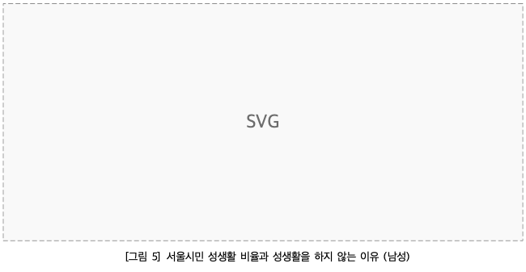
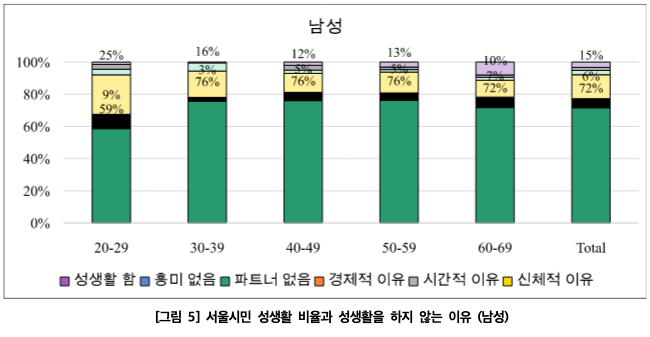
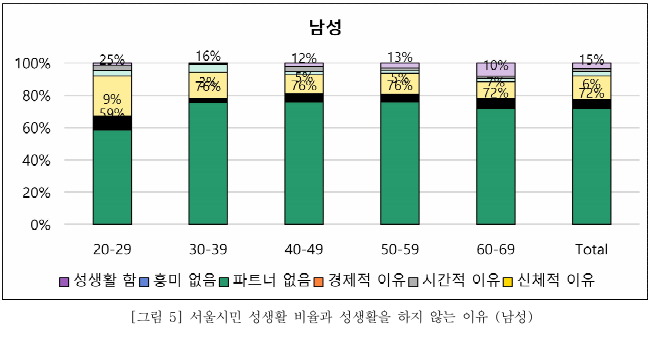

# Task #612 — Quick Look OLE 차트 최종 보고서

## 작업 요약
- 이슈: [#612](https://github.com/postmelee/alhangeul-macos/issues/612), M020, 총 3단계.
- Finder 제공자는 `/Applications/Alhangeul.app/Contents/PlugIns/AlhangeulPreview.appex`(0.2.4 build 22)였다. 본앱은 사용자의 정상 표시 확인을 기준으로 정정했다. Jangster의 별도 OLE 제보와 동일 문서라고 판단하지 않는다.
- 기존 Swift CoreGraphics 경로는 단일 래스터 image SVG만 지원하므로 이 문서의 g/line/rect/text 벡터 RawSvg가 자리표시자가 됐다.
- 개체 단위 core rasterize 함수는 비공개이며 공개 FFI는 페이지 단위다. 새 ABI 대신 허용된 RawSvg가 있는 Quick Look 페이지만 공개 core/Skia PNG로 렌더링한다. 원본·core pin·본앱·Thumbnail 기본 정책은 유지했다.

## 변경 파일과 영향 범위

| 파일 | 내용 |
|------|------|
| Sources/Shared/HwpPageImageRenderer.swift | XML allowlist·bytes/개수/깊이/bbox 예산 및 페이지별 자동 선택, 선택 이유 진단 |
| Sources/Shared/HwpPreviewPNGRenderer.swift | 자동 요청과 실제 출력 모드 구분 |
| Sources/QLExtension/HwpQuickLookPNGReplyModeResolver.swift | Quick Look 기본 자동 모드, 명시적 디버그 모드 보존 |
| Sources/Shared/NativeFonts/ExtensionFontRenderer.swift | PNG/PDF 공급 경로 적용, 글꼴 실패·현재성 처리 유지 |
| Sources/QLExtension/HwpPreviewProvider.swift | 선택 이유를 문서 내용 없이 진단 |
| scripts/quicklook_raw_svg_regression.swift | 정책 경계·실제 확장 공급·PNG/PDF 회귀 |
| scripts/compare-raw-svg-reference.swift / test-quicklook-raw-svg.sh | 독립 Poppler 기준 PDF와 영역별 누락 비교 |
| scripts/quicklook_skia_policy_smoke.swift / preview_visual_diff_harness.swift | 신규 정책에 맞춘 기존 검증 도구 |
| .github/workflows/pr-ci.yml / scripts/ci/classify-pr-changes.sh | Poppler 설치와 회귀 실행, 변경 경로 분류 |
| samples/issue7406/ | 원본 HWP/PDF 및 출처·SHA-256 |
| mydocs/plans·working·orders·report | 계획, 단계 보고, 완료 기록과 비교 근거 |

## 변경 전·후 비교

| 항목 | 기존 CG | 자동 선택 | 기준 PDF |
|------|--------:|----------:|---------:|
| 검출 막대 | 0 | 6 | 6 |
| 차트 녹색 픽셀 | 0 | 25,703 | 25,560 |
| x축 ink 픽셀 | 0 | 813 | 777 |
| y축 ink 픽셀 | 0 | 702 | 730 |
| 범례 ink 픽셀 | 335 | 3,497 | 2,962 |
| 캡션 ink 픽셀 | 1,600 | 2,073 | 1,044 |

녹색 면적 비율은 1.005594679이다. 영역별 ink 검사는 누락 탐지이며 글자 정확도나 픽셀 동일성 증명이 아니다. 직접 비교에서 6개 막대, 0~100% 축, 연령별 x축과 Total, 한국어 범례 6개, 캡션을 확인했다. 캡션 글꼴·굵기와 일부 선/기준선 차이가 남는다. 기준 PDF에도 일부 수치 라벨 겹침이 있다.

| 기존 | 개선 | 기준 PDF |
|------|------|---------|
|  |  |  |

[영역별 원시 수치](assets/task_m020_612/reference-comparison.json). 기준 PDF는 Poppler로 794×1123에 렌더링했다. 최종 회귀 실행의 차트 PNG는 63,928 bytes, 총 시간 567ms였다. 별도 재실행은 468ms이며 성능 보장 수치가 아니다. time -l의 sysctl 권한 오류로 peak RSS는 측정하지 못했다.

## 검증 결과

| 수용 기준 / 실행 | 판정 | 근거 |
|----------------|------|------|
| 차트·축·범례 복원, 캡션 보존 | OK | test-quicklook-raw-svg.sh 및 독립 PDF 영역 비교, 직접 이미지 확인 |
| 일반 페이지 CG, 제한된 벡터만 Skia | OK | KTX, 중첩/혼합 RawSvg, 명시적 CG, 9쪽 PDF |
| malformed/외부참조/DTD/entity/CSS/과대 입력 거부 | OK | 정책 경계 runner |
| 글꼴 거부·stale 처리 | OK | 실제 ExtensionFontRenderer 격리 실행 |
| 원본 보존 | OK | HWP/PDF SHA-256 일치, samples README 기록 |
| AppKit 경계 | OK | scripts/check-no-appkit.sh |
| 기본 렌더 회귀 | OK | scripts/validate-stage3-render.sh, render-debug-compare.sh; 순수 CG 결과 byte 동일 |
| 기존 명시적 Skia 모드 | OK | scripts/smoke-quicklook-skia-policy.sh 차트/KTX |
| Release HostApp/Preview 빌드 | OK | xcodebuild CODE_SIGNING_ALLOWED=NO, BUILD SUCCEEDED |
| shell/patch/CI 분류 | OK | bash -n, git diff --check, macOS build/render smoke 활성 확인 |
| 새 후보의 Finder 설치 smoke | MISS | 설치·서명·배포 없이 격리 확장 코드와 Release 빌드까지 검증 |
| macOS 12 / Intel runtime | MISS | 컴파일 target과 실제 해당 환경 실행은 구분 |

검증 산출물과 전체 로그는 작업 worktree의 `build.noindex/task612/`에 보관했다. 재현 명령은 `scripts/test-quicklook-raw-svg.sh build.noindex/quicklook-raw-svg`이다. 기존 lock과 일치하는 xcframework를 재사용했으며 Rust/ABI 변경은 없다.

## 잔여 위험과 후속 작업
- 페이지 단위 Skia 선택으로 주변 텍스트·캡션의 글꼴 fallback이 CG와 다를 수 있다. 개체 단위 core 래스터 FFI 공개는 별도 범위다.
- 허용 목록 밖의 유효 SVG, 글꼴 공급 실패, Skia 실패에는 기존 CG 자리표시자가 남을 수 있다. 부분집합 정책은 모든 SVG의 보안·시각 동등성을 보증하지 않는다.
- 배포 후보를 이용한 표준 Finder smoke와 최소 OS/Intel 실행, 대표 문서의 메모리 측정은 후속 검증 대상이다.
- 표준 registration hygiene 정리와 이번 빌드 내부 Sparkle Updater 등록 해제 후 개발 등록은 `(none)`, 활성 제공자는 `/Applications/Alhangeul.app`으로 확인했다. 기존 `/Volumes/T7/.Trashes/501/알한글.app` 항목 때문에 전체 hygiene는 exit 1이다. 이를 통과로 표기하지 않으며 기존 휴지통 앱은 변경하지 않았다. 개발 산출물은 build.noindex 안에만 존재한다.

## 작업지시자 승인
PR 생성까지 명시 승인에 따라 구현·검증·게시를 진행했다. PR 리뷰 후 병합 여부는 작업지시자가 결정한다.
