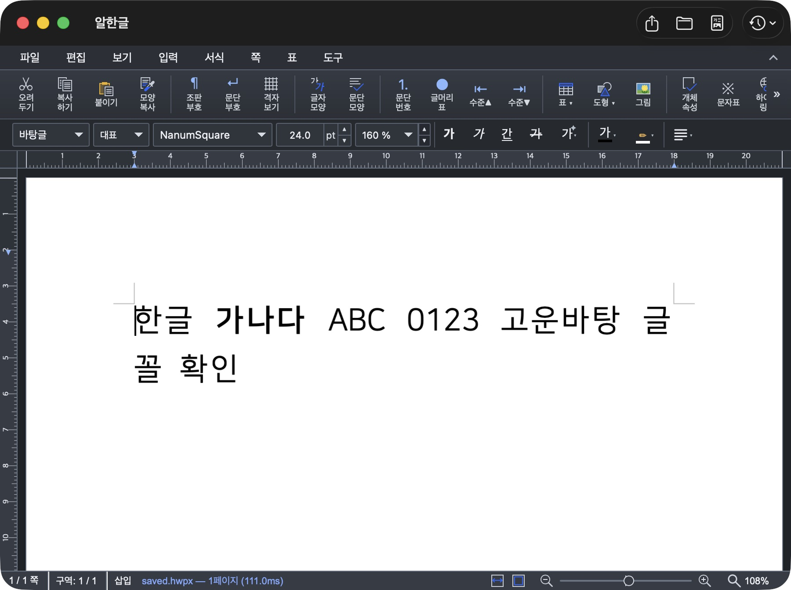
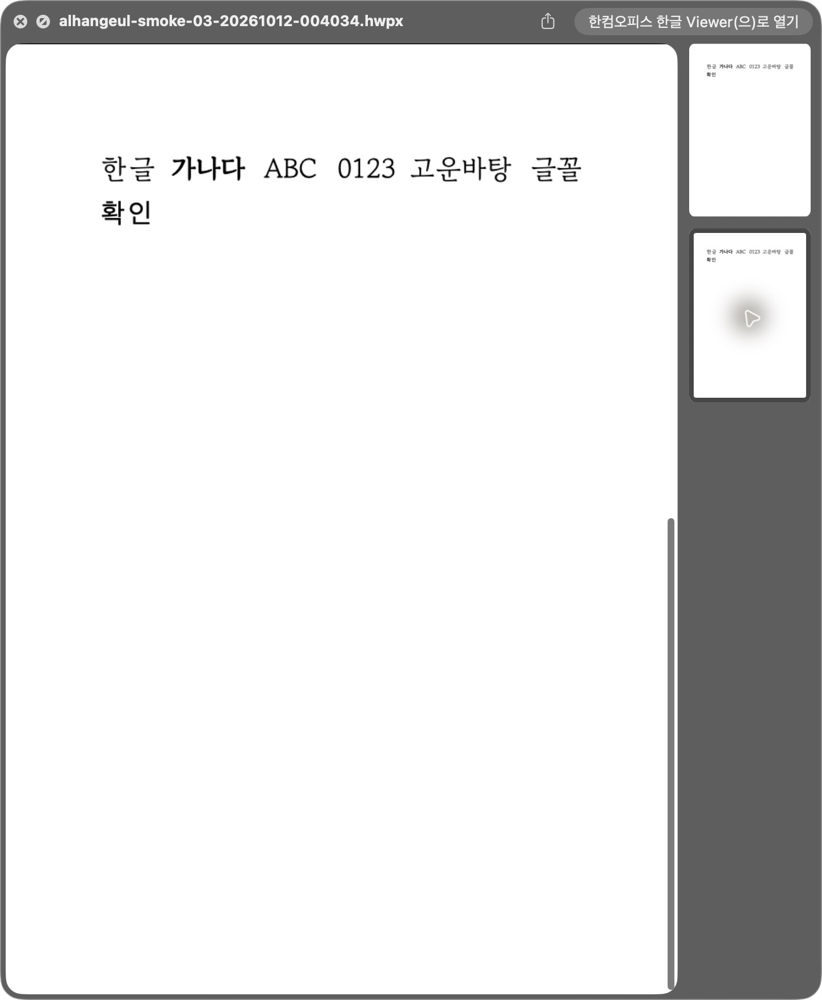

# Task M020 #569 Stage 4 — 동일 소스 Mac 수용

- 일자: 2026-10-12, 작업 `local/task569`.
- 승인: 웹 안내와 Mac 최종 수용을 함께 명시 지시받아 Stage 3 보고/커밋 `46b3d668` 후 기존 Stage 4의 후보·검증 준비를 이어간다.
- 구체 실행 승인: 2026-10-12 작업지시자의 “로컬 서명·임시 시험·원상복원 허용”. 고정 후보/fixture·기존 인증서·설치 대상·UUID 보관함·복원 계획을 승인받았다.
- 현재: **4.2 승인된 동일 후보의 Mac 주요 수용·출력/변경 회귀·원래 앱과 등록 복원·고유 보관함 정리 완료. 2026-10-12 작업지시자가 결과를 수용하고 “Stage 4 수용·Stage 5 준비 진행”을 승인했다. [Stage 5](task_m020_569_stage5.md)에 인계했다.**

## 1. 구체 후보

| 항목 | 준비 결과 |
|------|-----------|
| 제품 소스 | `46b3d66828bc2616842abdff6821b4aea3aed162`, Swift 126개 현재 hash 일치. 이후 변경은 도구/문서만 |
| 후보·fixture | `build.noindex/task569/stage4/finder-candidate-01/`의 `Alhangeul.app`·`FontExtensionFixtureProbe.app` |
| 시험 marker/build | `88FFC8FB-E8C2-47D6-A818-08FDA89C2CC2` / `569.4.1`, `ALHANGEUL_FONT_EXTENSION_PROBE` Release. 공개 버전이 아님 |
| 후보 inventory digest | `8c16a46027f4b388c282d08f4b1910f71407040bcd336b27139e5f3f095e3a4c` |
| fixture inventory digest | `fca79bbed0f0ee02292b8fe606a457bf593ee4f66008e01cca971ddb547d9a14` |
| 소유 보관함 | App Group의 `Library/Application Support/FontLibrary/v1/extension-probes/88FFC8FB-E8C2-47D6-A818-08FDA89C2CC2` |
| 입력/글꼴 | 고정 hash의 단일 HWP·HWPX·2페이지 HWPX, 기존 OFL Gowun Batang R/B와 사용 조건 파일 |
| 기존 인증서 | `Developer ID Application: Taegyu Lee (XH6JHKYXV8)` 기존 인증서로 로컬 서명 완료. 공증/배포 없음 |

후보의 `preparation.json`·`operation-plan.json`과 [요약 영수증](assets/task_m020_569_stage4/candidate-preparation.json)을 보존한다. 앱/DMG·글꼴 bytes·사용자 catalog/bookmark는 커밋하지 않는다.

## 2. 도구 보정·사전 검증

prepare/Finder helper는 기존 #568/#580 경계를 유지하며 #569의 `stage4` 경로와 task receipt만 추가 허용한다. 전 제품 source set·fixture/core/Studio/native/input hash·unsigned/signed 전체 inventory·원래 앱 inventory·고유 marker·실행 중 앱 거부·모드 분리·실패 자동 복원을 유지한다.

- 기본 Release는 Stage 3, 같은 제품 소스의 진단 Release는 이번 준비에서 HostApp/두 확장 포함 빌드 성공.
- #569 guard 16개와 기존 #580 guard 16개 통과. 외부 명령은 mock으로 차단하여 서명/설치를 실행하지 않았다. 세 Python helper 문법 검증 통과.
- 준비 후 Swift 126개·후보/fixture inventory 재대조 일치.
- 원래 `/Applications/Alhangeul.app`만 provider, 개발 등록/legacy/issues 0. 필요한 후보 앱 존재 경고 1은 유지한다.
- #580의 승인된 성능 결과와 <300ms 후속 #581 분리를 그대로 인계한다. 새로운 최적화 목표를 시작하지 않는다.

## 3. 승인 후 실제 수용

1. 고정 후보/fixture를 기존 인증서로 로컬 서명하고 strict/deep seal·entitlement·signed inventory를 기록한다.
2. 원래 앱/사용자 문서 창·준비 당시 원본 inventory를 확인하고 백업 후 표준 smoke 안에서 잠시 교체한다. guard 실패 시 설치하지 않는다.
3. 고유 보관함만 설정한다. 같은 제품 소스의 실제 설정/face·기존 글꼴 목록·HWP/HWPX 저장/재열기·재실행을 확인하고 제품 후보/격리 probe 차이를 기록한다. 실제 Help 클릭과 아직 미공개인 URL 상태도 구분한다.
4. 실제 저장 PDF의 PS/program·한글 원문/검색·확대 화면, immutable print payload와 macOS 패널 열기/취소를 확인한다. 필요한 driver 보완은 기존 수용 범위 안에서 추적한다. 물리 프린터로 전송하지 않는다.
5. Finder 단일 PNG/다중 PDF·Thumbnail·정책/소유 객체/원본 변화·복구와 자원 수명을 확인한다. OS가 요청하지 않은 표시를 새 성공으로 합산하지 않는다.
6. 성공/실패 모두 원래 앱·등록을 복원하고 UUID 저장소·자체 worker/창을 정리한 뒤 최종 수용표에 취합한다.

실제 창/패널 시험 전에 Mac 잠금 해제 상태를 확인한다. 이번 준비 말미에는 Mac이 잠겨 있었으며 추가 UI 조작을 하지 않았다.

## 4. 백업·원상복원 계획

- 설치 대상: `/Applications/Alhangeul.app`, 현재 v0.2.2.
- 원본 파일/링크/권한 243개, digest `fa694017af3e0b3705510b353ef0e9dc5549be57493b74e99e5ca05540b3707b`.
- 백업: 후보 폴더의 `backup/Alhangeul.app`. 설치 직전에 `ditto` 후 strict seal·준비 당시 inventory 일치를 확인한다.
- 실패는 helper 복원 경로로 회복한다. 다른 작업이 설치본을 변경하면 자동으로 덮어쓰지 않는다.
- 복원 시 bytes/링크/권한·strict 서명·원래 provider를 확인한다. xattr 전체 비교를 보증한 결과로 표현하지 않는다.
- 전역 cache reset·다른 앱 등록 변경·사용자 OS 글꼴/한컴 앱/원본문서 변경·공개 Release/Pages/appcast는 제외한다.

## 5. 공간 정리와 다음 gate

후보 inventory 확인 후 완료된 Stage 3 앱 3개·옛 dSYM과 복사 완료한 Stage 4 raw 앱을 정리했다. **716,686,096 bytes(약 683MiB, 논리 크기)**이며 실제 가용 공간 증가량과 같다고 주장하지 않는다. 후보/fixture·새 dSYM·package/module cache·로그/JSON/그림·OFL 원본/문서 입력은 보존하고 자체 Sparkle 하위 등록까지 해제했다.

위 고정 후보와 복원 계획의 **기존 Developer ID 로컬 서명·임시 Finder/Mac 출력 시험·원상복원**을 승인받아 실행한다. 구현계획 §5는 “서명/임시 설치 시험은 구체 후보·인증서·설치 대상·백업/복원·고유 보관함이 준비된 뒤 승인된 범위에서만 실행”하도록 정했다. Windows/최소 OS/Intel runtime·실제 한컴 제거·물리 프린터 및 #569/#562 전체 잔여 조건은 유지한다.

## 6. 동일 Developer ID 후보의 실제 앱 동선

기존 인증서로 후보/fixture·두 확장·Sparkle·Spotlight importer를 서명하고 strict/deep seal을 통과했다. signed 전체 inventory는 앱 `01c404a6c29859143155781ce266dd662972689b52ad5f27a3d7f29f5c6c8b8f`, fixture `f24883b861a31dcec7719e167140cecd1a1624c6c8a4b1f0fea696c58eddc23c`다. 원래 v0.2.2 앱을 백업한 뒤 표준 smoke의 preserve-signature/scoped/skip-global-reset 경로에서만 잠시 교체했다.

arm64/macOS 26.5.2 (25F84), Host PID 53744 → 새 프로세스 63430에서 실제 제품 Scene과 메뉴를 사용했다. 제품 Swift 126개는 준비 때와 계속 같고 core/Studio/native 산출물도 유지했다.

| 실제 동선 | 판정 |
|-----------|------|
| ⌘, → 글꼴 → Mac에 설치된 글꼴 사용 | 활성화·감지 232 family. 재실행에서 ON 유지. private catalog의 809 records/grants 0을 정리 직전 확인 |
| 기존 글꼴 목록 → 시스템 글꼴 | 205 family 표시·실제 NanumSquare 선택. OS 목록에 UUID 보관함 Gowun family가 추가된 수이며 가상 목록이 아님 |
| HWP/HWPX 편집·저장/재열기 | 실제 open/save-as 패널로 별도 `saved.hwp`/`saved.hwpx` 저장. 새 프로세스의 최근 문서에서 다시 열어 NanumSquare 표시 |
| 저장 bytes의 독립 재열기 | bundled WASM으로 원문·NanumSquare family·Regular/Bold·내부 renderer alias 제외 통과 |
| 실제 PDF 저장 | 두 형식의 native PDF 패널로 별도 파일 저장. PDFKit 원문·`한글` 검색/선택 각 1건·R/B font program·ToUnicode, Poppler 및 pypdf 대조 통과 |
| 실제 인쇄 | 두 형식에서 macOS 패널 열기 → 취소 → 문서 복귀 확인. 프린트 버튼·프린터 전송 실행 없음 |
| 새 Help 메뉴 | 실제 클릭으로 기본 브라우저에서 `https://postmelee.github.io/alhangeul-macos/fonts/` 열림. 현재 404는 웹 안내 미게시 상태이며 공개 gate에서 페이지와 앱을 함께 반영해야 함 |

HWP는 적용 언어를 한글로 바꾸었으므로 영문 Gowun face가 별도로 남고, HWPX는 대표 언어의 전체 채널을 NanumSquare로 바꾸었다. 저장본/실제 PDF font resource에서 이 차이를 확인했다. 일반 한글 가로 본문 static R/B 결과를 다른 축·효과·전체 조판으로 확대하지 않는다.

[실제 앱/출력 요약](assets/task_m020_569_stage4/native-acceptance.json), [저장 core 증거](assets/task_m020_569_stage4/saved-core-proof.json), [PDFKit 증거](assets/task_m020_569_stage4/pdfkit-proof.json), 두 pypdf font resource JSON과 확대 PNG를 보존했다. pypdf는 빈 객체 6/8의 잘못된 포인터를 무시하는 경고를 냈다. 이를 숨기지 않으며 PDFKit/Poppler의 원문·검색·font program 확인과 구분한다. 해당 PDF 전반의 구조 적합성을 보증하는 시험은 아니다.

## 7. 현재 소스의 격리 출력 회귀

기존 `probe-studio-output-acceptance.py`를 새 `build.noindex/task568/stage3/task569-current-output-01`에서 실행했다. #568 driver의 경로 guard는 변경/우회하지 않았다. 기록 입력 188개 모두 현재 hash 일치이며 private bundle/container, ad-hoc sandbox 서명이다. Developer ID 후보의 실제 패널과 같은 binary로 표현하지 않는다. HostApp.swift/UpdateController.swift entry는 제외하고 제품 Coordinator·provider·job·renderer를 사용한다.

- 관리 Gowun R/B: 29 check, 실제 reads 16.
- 실제 설치 NanumSquare R/B: 25 check, 실제 reads 14.
- 공급 없는 Noto 대조: 16 check, 로컬 reads 0.

총 70 check는 두 형식의 실제 출력 원문·PS/program·ToUnicode·검색, 필요한 face의 제한된 읽기, bytes 반환 직후 취소/기존 목적지 보존·늦은 결과 폐기, private 원본 상실/복원·새 snapshot 재출력, 문서 bytes/dirty/changeSeq 보존, immutable 인쇄 PDF seal/close를 확인했다. callback `false`는 실제 패널 취소와 구분한다. 실제 I/O 진행 중 OS 취소나 물리 인쇄로 확대하지 않는다. [provenance](assets/task_m020_569_stage4/output-provenance.json) 및 관리/설치/기본 결과 JSON을 보존한다.

임베딩 제한 face의 실제 GUI 경고·명시 대체 동선을 이번 시험에서 새로 만들지는 않았다. #568 정책/주입 검증과 구분하며 현재 fallback 계약의 최종 회귀는 Stage 5에 인계한다.

## 8. 같은 후보의 Finder·변경/복구

표준 smoke는 고정 입력 3개를 fresh 경로에 복사해 실제 Thumbnail PNG 3개를 생성했다. 실제 Finder에서 아이콘 보기와 단일 HWP/HWPX의 PNG Quick Look, 2페이지 HWPX의 PDF Quick Look·2페이지 선택을 확인했다. 자체 확장 로그에 정확한 Gowun R/B, 공급 fallback 없음, 단일 PNG 두 건과 PDF 2페이지·fallback pages 0이 대응했다. 표준 smoke 이후 새 확장 crash report는 0이다.

- Thumbnail PID 52813 / image UUID `E36431C8-E1FC-3A19-8EB2-E07D9B9D8DEC`.
- Preview PID 65891 / image UUID `0646BA41-6D42-3467-BDD7-C2D73796C9BA`.
- 기본 backend는 CoreGraphics다. 이번 실제 Finder 성공을 Skia 기본 전환으로 표현하지 않는다.

같은 `current.hwpx` 경로·bytes·mtime를 유지하며 고유 보관함의 ON baseline → OFF → 관리 충돌 추가 → variant 선택 → 선택 복원 → 권한 거부 → 권한 복구 → 객체 누락 → 객체 복구 → ON 복원 10개 phase를 실행했다. fixture 명령과 최종 복구 exit는 모두 0이고 매 phase에 실제 확장 요청 2건이 대응했다.

8개 정상 phase의 16건은 정확한 R/B·첫 miss/다음 exactHit이다. 권한 거부 2건은 `io(13)`, 객체 누락 2건은 `corruptObject`의 명시적 공급 fallback이고 매번 miss다. callback 성공 20건을 정확한 글꼴 공급 성공 20건으로 표현하지 않는다. 변경마다 identity가 달라지고 복구 뒤 정확한 공급/재사용으로 돌아왔다. [변경 증거](assets/task_m020_569_stage4/boundary-proof.json)는 PID/image UUID·시각 구간·실제 callback/PNG hash를 연결한다.

새 정상 GUI/직접 요청을 확인한 정확성 시험이며 새로운 300ms 목표나 전체 Finder 표시 시간의 성능 수용을 선언하지 않는다. #580의 accepted 측정과 후속 #581 분리를 유지한다.

## 9. 원상복원·소유 정리

HostApp·시험 패널을 종료하고 marker/정확한 실행 경로로 확인한 Preview/Thumbnail worker만 종료했다. wrapper로 원래 v0.2.2 앱과 등록을 복원했다. 파일/링크/권한 243항목과 digest `fa694017af3e0b3705510b353ef0e9dc5549be57493b74e99e5ca05540b3707b`가 준비 당시와 일치하며 strict 서명과 probe marker 부재를 확인했다. xattr 전체 비교나 전체 UserDefaults/최근 문서 backup/restore를 수행한 결과로 표현하지 않는다. 실제 앱의 일반 최근 문서 동작은 사용했으며 사용자 문서 bytes를 변경하지 않았다.

공유 UUID는 signed fixture `--cleanup` exit 0으로 제거했다. private catalog는 macOS의 opaque 컨테이너에 있었다. 예상 bundle ID/옛 이름 경로의 ENOENT와 보호된 metadata 접근 거부 후, catalog 파일명과 승인 UUID만 `rg --files`로 확인했다. schema 1·ON·809 records/grants 0, 419133 bytes인 해당 UUID 경로만 제거했다. 다른 catalog·OS 글꼴·전역 권한/캐시는 변경하지 않았다. [private 정리 증거](assets/task_m020_569_stage4/private-catalog-check.json)를 보존한다.

현재 출력 probe의 세 private run은 작업 폴더에 복사한 뒤 소유 label만 정리했고 개발 등록도 없다. 후보/fixture·백업·staging·출력 probe 앱 5개를 정리해 **1,162,524,634 bytes(약 1.08GiB, 논리 크기)**를 줄였다. 실제 디스크 가용 증가량으로 단정하지 않는다. 영수증·raw log/JSON·문서/PDF/PNG·필요 dSYM/module/package cache는 보존한다.

마지막 hygiene는 `/Applications/Alhangeul.app` provider 하나, 개발 등록/개발 앱/legacy/issues/warnings 모두 0이다. [복원·산출물 정리 증거](assets/task_m020_569_stage4/restoration-and-cleanup.json)와 21개 evidence의 SHA256SUMS를 남겼다.

## 10. 판정과 다음 gate

**승인된 동일 소스·Developer ID 진단 후보의 Mac 주요 동선·출력/변경 회귀·원상복원은 완료했다.** 제품 소스는 바꾸지 않았다. 현재 기능의 Mac 선출시 준비 근거이며 probe flag 없는 최종 signed/notarized DMG나 공개 릴리스 통과를 대체하지 않는다.

다음 Stage 5는 필요한 현재 fallback/회귀와 웹·Help/증거 대조, 최종 보고·부분 PR/release 운영 인계다. Stage 종료 승인과 공개 push/PR 승인 gate를 유지한다. macOS 12/Intel runtime·실제 한컴 제거·TTC/가변/HFT·물리 인쇄·Windows·최종 DMG/Pages 공개는 미검증/미완료로 유지한다. #569/#562는 닫지 않는다.
