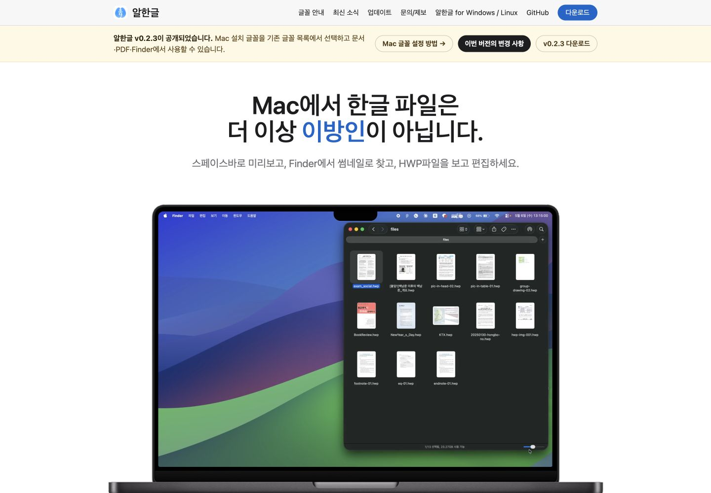
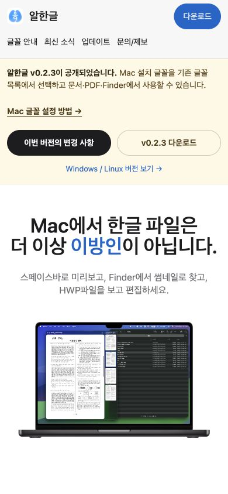

# Task M020 #590 Stage 1 — 글꼴 안내 진입점과 모바일 헤더

## 1. 결론과 승인

공통 헤더의 **글꼴 안내**와 홈 v0.2.3 배너의 **Mac 글꼴 설정 방법 →**을 구현했다. 모바일에는 로고/다운로드와 주요 메뉴를 두 줄로 표시하고, 기존 보조 링크는 푸터에서도 접근하게 했다. 기본 데스크톱 1440×1000과 모바일 390×844의 실제 브라우저 화면에서 가로 넘침·헤더 겹침이 없음을 확인했고, 헤더와 배너를 실제 클릭해 글꼴 안내 도착을 확인했다.

2026-10-15 작업지시자의 **“#590 구현계획과 Stage 1 실행을 승인할게. 진행하고 데스크톱·모바일 화면을 보여줘.”**에 따른 실행이다. [구현계획](../plans/task_m020_590_impl.md)의 Stage 1 범위만 완료했다. 전체 화면 폭·경계 폭·하위 페이지·키보드 검증은 Stage 2 승인 후 진행한다. 공개 push/PR·병합·Pages 배포는 실행하지 않았다.

## 2. 변경 결과

- HTML 21개에 상대 경로가 맞는 글꼴 안내 링크와 CSS 참조 버전을 반영했다. 글꼴 페이지는 `aria-current="page"`와 색상/굵기로 현재 위치를 표시한다.
- 홈 배너에 설정 방법 링크를 추가했다. 데스크톱의 배너 링크는 같은 줄로 표시하고, 모바일은 설정 방법을 넓게 누를 수 있는 독립 행으로 둔다.
- 700px 이하에서 높이 100px의 두 줄 sticky 헤더를 사용한다. 주요 메뉴·기존 다운로드는 44px 높이이며 글꼴 안내를 숨기지 않는다. 기존의 아주 좁은 화면 로고 문자 숨김과 페이지별 간격 충돌을 제거했다.
- 820px 이하의 Windows/Linux·GitHub 보조 링크 숨김을 공통으로 정리하고 푸터 목적지를 유지/추가했다. 최신 소식에는 같은 목적의 작은 푸터를 추가했으며 feed 본문은 유지했다.
- 최신 소식·문의의 현재 다운로드 URL과 접근성 이름을 v0.2.3으로 맞췄다. 과거 릴리즈별 다운로드는 그대로다.
- 글꼴 목차의 스크롤 여백이 실제 헤더 높이를 참조하게 하고, 관련 초점·현재 위치 규칙을 공통 위치에 정리했다.

## 3. 검증과 보존

| 검증 | 결과 / 근거 |
|------|-------------|
| 전체 헤더 | [구조 검사](../report/assets/task_m020_590/stage1/structural-check.json): 21개 모두 글꼴 링크 한 개, CSS 참조·보조 목적지 확인 PASS |
| 본문·이전 안내 | [변경 전 manifest](../report/assets/task_m020_590/stage1/baseline.json)의 21개 main 원문 hash·이전 버전 배너 대조 PASS. 홈 배너만 승인 범위로 변경 |
| 기존 다운로드 | 이전 노트 16개를 포함해 최신 소식/문의 두 곳 외 다운로드 속성 그대로 PASS. 두 현재 페이지는 v0.2.3 URL/이름 PASS |
| appcast | 저장소 `docs/appcast.xml` hash 유지 PASS. 원격 공개 피드를 저장소 파일과 같다고 가정하거나 교체하지 않음 |
| 데스크톱 기본 | [1440×1000 기록](../report/assets/task_m020_590/stage1/desktop-basic.json): document 폭 1440, 헤더 높이 52, 배너 링크 같은 y 위치. 화면에서 겹침 없음 |
| 모바일 기본 | [390×844 기록](../report/assets/task_m020_590/stage1/mobile-basic.json): document 폭 390, 헤더 높이 100. 주요 링크/다운로드 높이 44, 보조 링크 숨김 확인 |
| 실제 클릭 | [도착 기록](../report/assets/task_m020_590/stage1/link-clicks.json): 데스크톱 헤더·모바일 배너 모두 `/fonts/`, 제목 ‘Mac 글꼴 사용 안내 — 알한글’, 현재 메뉴 한 개 |
| 공백·범위 | `git diff --check` PASS. 변경은 대상 HTML/CSS·#590 문서/증거이며 앱/core/Studio·workflow·Cask·배포 피드는 미변경 |

실제 화면 확인은 Codex 내장 브라우저의 지정 viewport다. 실제 휴대폰·다른 브라우저, 320px/중간·경계 폭 또는 전체 키보드 수용을 통과한 것으로 확대하지 않는다. 본문은 원문으로 보존했으나 공통 CSS의 시각 영향은 Stage 2 대표 페이지에서 추가 검증한다.

## 4. 사용자 확인 화면과 로컬 미리보기

- 홈: [http://127.0.0.1:61371/](http://127.0.0.1:61371/)
- 글꼴 안내: [http://127.0.0.1:61371/fonts/](http://127.0.0.1:61371/fonts/)
- `docs/`를 직접 제공하는 이번 작업 전용 loopback 서버 PID 94547. 사이트/동영상 전체 복사본을 만들지 않았다. 서버 실행 receipt는 `build.noindex/task590/stage1/server.json`에 있다. 사용자가 직접 확인할 수 있게 유지한다.
- 임시 viewport override는 화면 저장 후 해제했고 홈 미리보기 탭을 유지했다. 창 너비에 따라 실제 배치가 바뀐다. 아래 화면은 당시 지정 viewport다.

데스크톱 1440px:

모바일 390px:

스크린샷 실제 형식은 JPEG이며 확장자와 일치한다. [Checksum](../report/assets/task_m020_590/stage1/SHA256SUMS)으로 선별한 7개 증거 파일을 대조한다.

## 5. 다음 단계

**Stage 1 결과 수용·Stage 2 실행 승인을 요청한다.** 다음에는 320·360·390·768·1024·1440px와 경계 폭, 대표 하위 페이지·앵커·키보드 초점/링크 동작을 검증하고 필요한 같은 범위 보정을 진행한다. 이후 Stage 3 최종 회귀·보고 및 공개 게시/배포는 별도 승인 대상이다.
