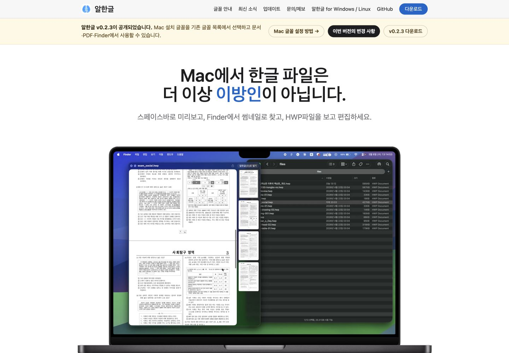
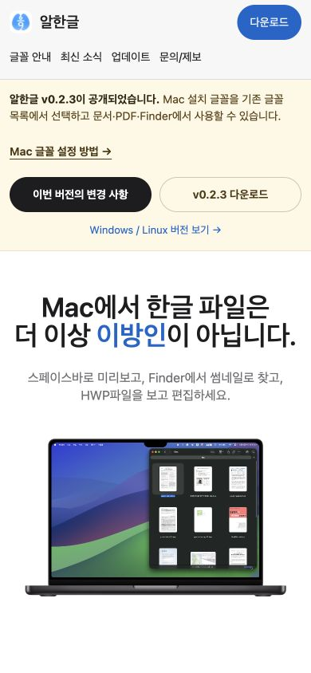
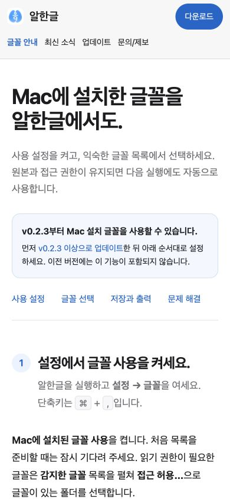

# Task M020 #590 Stage 2 — 전체 화면 폭·키보드 검증

## 1. 결론과 승인

승인된 화면 조합 25개, 글꼴 목차 8개 최종 위치, 홈 헤더/배너 Enter 진입 4개, 대표 하위 페이지 진입 5개를 확인했다. 가로 넘침·헤더 겹침·잘림이 없고 키보드 초점·본문 바로가기·푸터 보조 링크가 동작한다. **추가 HTML/CSS 수정은 필요하지 않았다.** 제품 소스는 Stage 1.1 커밋 `a626a6de`와 동일하다.

2026-10-15 작업지시자의 **“수정한 화면 좋아. #590 Stage 1.1 결과를 수용하고 Stage 2의 전체 화면 폭·키보드 검증을 진행해줘.”**에 따라 [구현계획](../plans/task_m020_590_impl.md)의 Stage 2만 실행했다. Stage 3 회귀·최종 보고와 공개 게시/배포는 아직 실행하지 않았다.

## 2. 화면 검증

Codex 내장 브라우저에서 실제 화면을 확인하고 읽기 전용 DOM의 문서 폭·헤더 링크 경계도 함께 기록했다. [전체 25개 기록](../report/assets/task_m020_590/stage2/responsive.json)의 모든 조합에서 `scrollWidth == clientWidth`, 헤더 겹침/화면 밖 링크 0개다.

| 대상 | 실제 viewport (폭×높이, px) | 결과 |
|------|----------------------------|------|
| 홈 기본 | 320×844, 360×844, 390×844, 768×900, 1024×900, 1440×1000 | PASS. 로고·글꼴 안내·다운로드 표시, 배너 줄바꿈과 본문 읽기 가능 |
| 홈 경계 | 699/700/701×900, 819/820/821×900 | PASS. 700 이하 헤더 100px, 701 이상 52px. 보조 링크는 820 이하 숨기고 821에서 복원 |
| 글꼴 안내 | 320×844, 390×844, 1440×1000 | PASS. 홈과 같은 헤더, 현재 메뉴 한 개, 파란 안내 문구 없음. 320 목차는 자연스럽게 두 줄 |
| 최신 소식·문의·업데이트 목록 | 각각 390×844, 1024×900 | PASS. 각 메뉴 변형·본문·푸터 겹침 없음 |
| v0.2.3·v0.1.0 노트 | 각각 390×844, 1440×1000 | PASS. 이전 버전 안내 배너·본문/버전 다운로드 유지 |

최신 소식은 로컬 데이터의 **“새로운 소식을 준비하고 있습니다.”** 상태로 보였다. 외부 Threads 실제 글/임베드 수집을 이번 검증으로 수용한 것은 아니며 news 동작·데이터는 변경하지 않았다.

## 3. 키보드·동작과 보존

[동작·초점 기록](../report/assets/task_m020_590/stage2/behaviors.json), [요약](../report/assets/task_m020_590/stage2/summary.json)을 남겼다.

- 홈·글꼴 안내의 1440/390px에서 실제 Tab/Shift+Tab을 사용했다. 초점 테두리가 표시되고, 모바일 헤더의 숨긴 Windows/Linux·GitHub는 Tab 순서에서 제외된다. 로고 → 주요 링크 → 다운로드 → 본문의 기존 DOM 순서를 유지한다. 모바일 다운로드가 시각적으로 첫 줄 우측에 있는 배치도 확인했다.
- 본문 바로가기가 첫 Tab에 나타나고 Enter 후 `#main`으로 이동한다. 다음 Tab은 헤더를 반복하지 않고 본문 컨트롤로 이동한다. 홈 데스크톱은 smooth scroll 중간 관찰에서 초점이 화면 밖에 있었으나 최종 위치(상단 413px, 하단 539px)와 실제 초점 테두리가 보이는 것을 확인했다. 이를 미검증/실패로 남기거나 순간 관찰을 최종 결과로 사용하지 않았다.
- 홈 헤더와 배너를 각 1440/390px에서 Tab으로 선택해 Enter로 `/fonts/` 도착 PASS. 최신 소식·문의·업데이트 목록·v0.2.3/v0.1.0 노트의 헤더도 실제 클릭해 같은 도착 확인 PASS. 다운로드·이메일·외부 게시 버튼은 실행하지 않았다.
- 글꼴 목차 4개를 390/1440px에서 실제 클릭했다. 애니메이션 종료 위치를 확인해 모바일은 헤더 100px 아래 약 124px, 데스크톱은 헤더 52px 아래 약 76px(마지막 섹션은 페이지 끝 제한으로 약 296px)에서 제목을 읽을 수 있다.
- 모바일 글꼴 안내에서 Tab으로 푸터까지 이동했다. Windows/Linux와 GitHub를 초점으로 접근할 수 있고, GitHub 최종 초점은 화면 안에 표시됐다.
- [구조/보존 검사](../report/assets/task_m020_590/stage2/structural-check.json) PASS: HTML 21개 상대 경로·현재 다운로드·홈/글꼴 헤더 일치, 승인한 파란 문구 한 줄 제거 외 본문 보존, 릴리즈 노트 16개의 본문·기존 다운로드·과거 안내 배너 및 저장소 appcast 유지. 원본 Stage 1 manifest와 기존 증거는 덮어쓰지 않았다.
- `git diff --check`와 아래 증거 checksum·JPEG 형식·문서 상대 링크 검사를 통과했다. 이번 단계는 계획/오늘할일·보고·소형 증거만 변경한다.

실제 iPhone/Android나 Safari·다른 브라우저에서 검증한 결과는 아니다. Stage 3의 기존 news/Pages 회귀 명령·최종 보고·PR 초안은 다음 승인 범위다.

## 4. 직접 확인 화면

[홈 미리보기](http://127.0.0.1:61371/) · [글꼴 안내 미리보기](http://127.0.0.1:61371/fonts/)

기존 loopback 정적 서버(PID 94547)로 `docs/` 원본을 직접 제공한다. 글꼴 안내 탭을 유지하고 임시 viewport override는 해제했다. 앱·Rust 재빌드나 사이트/동영상 전체 복사본은 만들지 않았다. 선별한 증거는 [SHA256SUMS](../report/assets/task_m020_590/stage2/SHA256SUMS)로 확인한다.

데스크톱 홈 1440×1000:

모바일 홈 390×844:

모바일 글꼴 안내 390×844:

## 5. 다음 단계

**Stage 2 결과 수용·Stage 3 회귀/최종 보고·PR 초안 준비 승인을 요청한다.** Stage 3에서 계획한 기존 검사와 최종 보존·문서 검사를 수행한다. push/Open PR·병합·Pages 공개 배포는 별도 승인 대상이다.
