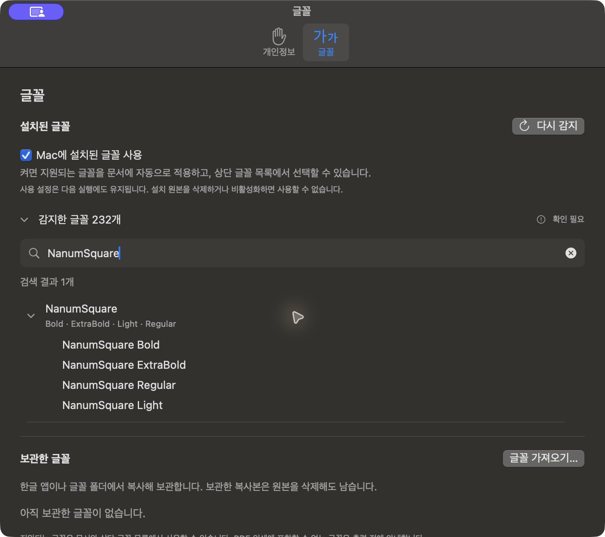
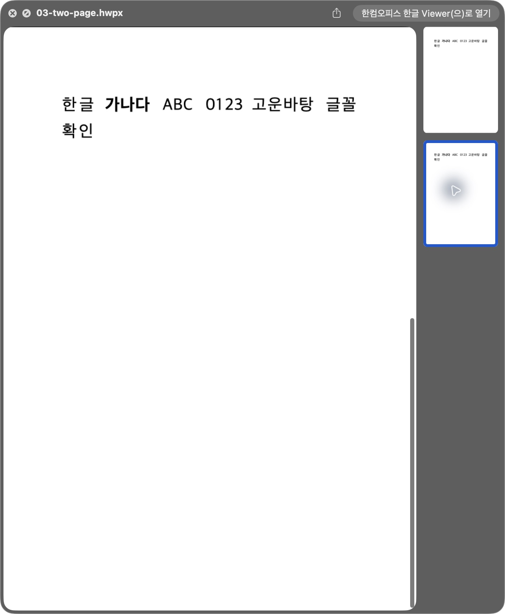

# Task M900 #584 Stage 4 최종 DMG Mac 시험·정리 보고

## 현재 상태와 실행 경계

**2026-10-12 “진행해줘”로 승인한 시험과 2026-10-13 정리 실행 종료. Mac 글꼴·저장/재열기·실제 PDF·인쇄 취소·Finder 주요 경로 PASS. 실제 Mac 검색은 ENVIRONMENT_UNAVAILABLE, 최근 문서 이력의 전체 사전 동등성은 미증명이다. 이 두 제한의 수용과 Stage 5 진입 승인을 기다린다.** [구현계획 §5](../plans/task_m900_584_impl.md)의 일반 최종 앱을 검사했으며 제품 재빌드·재서명·bundle 수정·진단 flag 주입은 없다. [Stage 3](task_m900_584_stage3.md)의 양 VM은 같은 DMG로 schema 3 PASS다. 공개 승격·Pages/Sparkle·Homebrew는 실행하지 않았다.

## 고정 후보·기존 앱·소유 문서

**실행 직전 범위 보정:** 사전 검사에서 /Applications/Alhangeul.app이 없음을 확인했다. 작업지시자가 “직접 삭제했음: 임시 설치·시험 후 앱 없음 상태로 복원”을 승인했다. 아래 0.2.2/20 inventory는 준비 시점의 역사적 기록이며 현재 앱 백업·복원 성공으로 사용하지 않는다. 이번에는 설정의 원래 상태를 보존하고, 시험 종료 후 후보 설치·등록을 제거해 앱 부재를 복원한다. 첫 inventory 검사는 앱 부재로 실패했으며 설치·설정 mutation 전에 발견했다.

| 항목 | 준비한 대상 |
|------|-------------|
| 원본 DMG | build.noindex/task584/stage3/publish/candidate/alhangeul-macos-0.2.3.dmg |
| SHA256 / size | d0050cb7de5d3fea17708aef1bebb7da54d326c7a540afbaf28276c3e50b1e63 / 211405232 bytes |
| source / publish artifact | c9d59f9300ef78b4cc6a3a8e17a10a3d766d01d4 / 11717953850 |
| 후보 | 일반 0.2.3 / build 21, 기존 Developer ID 서명·공증 완료. 로컬 재서명·bundle/Info 수정·진단 flag 주입 없음 |
| 기존 설치 대상 | /Applications/Alhangeul.app, 0.2.2 / build 20. 사전 조사 당시 실행 프로세스 없음 |
| 기존 앱 백업 예정 | build.noindex/task584/stage4/original-backup/Alhangeul.app, 아직 복사하지 않음 |
| 원본 inventory | 파일·symlink·mode·mtime 243개, 파일 bytes 총 446248370. 조사 시 deep/strict seal PASS |
| 소유 시험 문서 | build.noindex/task584/stage4/owned-documents/F779350F-3DE4-4E94-B7C2-A16578D1BA26의 font-single.hwp, font-single.hwpx, font-two.hwpx |
| 저장/복구 소유 문서 | 같은 경로의 protected.hwpx, legacy-hwp3.hwp, recovery-owned.hwpx. 이번 VM fixture artifact 11718713502에서 확보 |
| 시험 글꼴 | 기존 /Library/Fonts/NanumSquareRegular.ttf 및 NanumSquareBold.ttf. 읽기만 사용, OS 설치·삭제 없음 |

[기존 앱 조사](../report/assets/task_m900_584/stage4/preparation/original-app-summary.json), [복원 inventory](../report/assets/task_m900_584/stage4/preparation/original-app-inventory.json), [소유 문서 hash](../report/assets/task_m900_584/stage4/preparation/owned-documents.json), [글꼴·설정 경계](../report/assets/task_m900_584/stage4/preparation/font-settings-preparation.json)를 보존한다. 글꼴 시험 문서는 #569의 소유 합성 문서를 새 UUID 경로로 복사한 것이며, 새 앱에 #569의 진단 보관함/UUID를 주입하는 것은 아니다. 추가 문서 3개는 이번 후보 source의 VM fixture다. 저장/PDF 복사본도 이 경로 아래에 만든다.

## 임시 설치와 공간 사용

1. 실행 직전 실제 설치 버전·실행 여부·원본 inventory를 다시 확인한다. 원래 앱이나 사용자의 작업 상태가 달라졌다면 이전 상태를 가정해 덮어쓰지 않는다.
2. 원래 앱을 ditto의 resource fork·extended attribute·ACL 보존 방식으로 위 백업 경로에 복사한다. 파일 hash·mode·symlink 및 strict seal이 원래 앱과 일치해야 교체한다. 백업은 복원 검증 전 삭제하지 않는다.
3. 동일 DMG를 build.noindex/task584/stage4/source-mount에 읽기 전용으로 mount한다. 표준 helper의 staging 복사본을 사용해 별도 후보 앱 복사를 줄인다. 원본 DMG bytes와 서명을 유지한다.
4. 아래 표준 절차로 승인된 앱 경로만 교체하고 새 경로의 Finder 샘플을 만든다. 다른 앱 등록·전역 캐시·사용자 OS 글꼴은 변경하지 않는다. helper의 backup/restore 기능을 가정하지 않는다.

```sh
scripts/smoke-clean-quicklook-install.sh \
  --version 0.2.3 \
  --app build.noindex/task584/stage4/source-mount/Alhangeul.app \
  --install-app /Applications/Alhangeul.app \
  --replace-applications-install --preserve-signature \
  --scoped-registrations --skip-global-reset \
  --output-dir build.noindex/task584/stage4/finder-results \
  --sample build.noindex/task584/stage4/owned-documents/F779350F-3DE4-4E94-B7C2-A16578D1BA26/font-single.hwp \
  --sample build.noindex/task584/stage4/owned-documents/F779350F-3DE4-4E94-B7C2-A16578D1BA26/font-single.hwpx \
  --sample build.noindex/task584/stage4/owned-documents/F779350F-3DE4-4E94-B7C2-A16578D1BA26/font-two.hwpx
```

helper는 staging과 설치 경로에만 app을 복사하며 --preserve-signature에서 재서명하지 않는다. staging·원본 백업 공간을 우선 확보하고 실행 직전 여유 공간을 다시 확인한다. 사전 조사의 가용 공간은 약 6.9GiB이며 추가 로컬 Rust/Xcode 빌드·DMG 재생성·ZIP 중복 보존은 하지 않는다. Home의 별도 Alhangeul.app이 발견되면 자동 삭제하지 않고 충돌을 보고한다.

## 글꼴 설정·권한과 수용 동선

- 설정(⌘,) → 글꼴에서 Mac 설치 글꼴 ON/OFF와 실제 목록을 확인한다. 기존 시스템 글꼴 목록에서 NanumSquare Regular/Bold를 선택하고 감지 count는 실제 관측값으로 기록한다.
- 기존 설치 글꼴 파일의 읽기만 사용한다. 새 권한이 필요하면 표시된 폴더와 읽기 범위를 구체화한다. 보관함 import/delete·원본 글꼴 mutation은 이번 계획에 없다.
- 일반 앱의 HWP/HWPX 편집 → 소유 복사본 저장 → 재열기 → 새 프로세스의 설정 유지, PDF 저장·font/ToUnicode/텍스트/화면, macOS 인쇄 패널 열기·취소를 각각 기록한다. 진단 alias 저장이나 실제 프린터 전송은 하지 않는다.
- Finder의 single/multiple Quick Look·Thumbnail과 실제 provider 경로, 소유 문서의 Spotlight 본문 검색 및 앱 종료 후 검색을 구분해 확인한다. 자동 helper 추출 결과를 실제 UI 확인으로 바꾸지 않는다.
- #480 보호 원본의 경고·취소·hash 보존과 #525 소유 문서의 저장/닫기·복구 한계를 [수용표](../tech/task_m900_584_release_acceptance.md)에 기록한다. 보호 fixture는 이번 고정 source의 VM 생성 artifact에서 확보했고 합성 시험 암호는 test-only-spotlight다. 사용자 보호 문서를 사용하거나 암호를 요구하지 않는다. 기존 사용자 복구 항목은 조작하지 않는다.
- Help의 정확한 /fonts/ URL과 아직 미공개인 안내 상태를 구분한다. macOS 12·Intel 실기기 GUI·한컴 실제 삭제·물리 인쇄·Sparkle 업데이트는 이 Mac 시험의 PASS로 확대하지 않는다.

개인 설치 글꼴 목록은 HostApp container의 Alhangeul/InstalledFonts/installed-fonts-v1.json, 공유 ON/OFF policy는 App Group FontLibrary/v1/consumer-policy에 있다. 사전 조사에서는 두 JSON과 pending이 없었다. 실행 직전 존재 여부·원래 enabled·권한 grant와 hash를 다시 확인하고 **해당 파일만** 비공개 백업한다. bookmark나 사용자 목록 원문은 공개 증거에 넣지 않는다. 테스트로 생긴 항목만 정리하고 원래 설정/부재 상태를 복원한다. 전체 preferences·보관함·container 초기화는 하지 않는다.

## 실패 시에도 적용할 원상복원

1. 시험 앱과 시험 문서만 닫고, 신규 저장 파일/복구 후보의 소유 경로를 대조한다. 다른 사용자 문서나 기존 복구 항목은 건드리지 않는다.
2. 바꾼 설치 글꼴 설정을 원래 값으로 돌린 뒤 앱을 종료한다. 위 두 저장 파일의 원래 bytes/부재 상태를 필요한 범위에서 복원한다. 테스트 최근 문서의 정리도 소유 경로와 관련 key로 한정한다.
3. candidate와 owned staging의 QL/Thumbnail/LaunchServices 등록만 해제한다. 원래 앱 백업으로 /Applications/Alhangeul.app을 복원하고 그 경로의 기존 등록과 active provider를 확인한다. 전역 qlmanage cache reset이나 다른 앱 등록 제거는 하지 않는다.
4. 복원된 0.2.2/20의 파일 hash·mode·symlink·서명 및 설정의 원래 상태를 확인한다. 시험 mount·창·소유 출력 등록을 정리하고 원본 DMG hash 유지도 확인한다.
5. 복원 PASS 이후 staging/백업 중 더 필요 없는 app 복사본을 정리한다. 최소 증거·실패 원문·다운로드 원본 DMG는 보존한다.

원시 실패와 복원 실패를 성공으로 덮어쓰지 않는다. 실제 시험·복원 PASS와 공개 전 한계 수용을 확인하기 전에는 Stage 4 완료나 #584 완료로 표시하지 않는다. 공개 Release·Pages/Sparkle·Homebrew는 이후 별도 승인 대상이다.

## 실제 일반 앱의 수용 결과

실행 환경은 macOS 26.5.2 (25F84), arm64다. 2026-10-12 23:43 KST에 사전 상태를 확인하고, 표준 smoke로 일반 0.2.3/21을 설치했다. 후보와 staging의 strict/deep seal 및 정확한 /Applications provider 경로를 확인했다. source c9d59f9300ef78b4cc6a3a8e17a10a3d766d01d4, rhwp/Studio v0.8.7, DMG hash d0050cb7de5d3fea17708aef1bebb7da54d326c7a540afbaf28276c3e50b1e63을 유지했다.

| ID | 실제 결과 | 판단 |
|----|-----------|------|
| M1 | 처음 OFF → ON → 새 프로세스 ON 유지 → OFF → ON → 종료 전 OFF 복원. 실제 감지 232 family/809 records, 지원되는 시스템 목록 204개, OFF 시 0개. NanumSquare R/B/EB/L 표시 | PASS. 232개 모두 사용 가능하다는 의미가 아님 |
| M2 | 일반 HWP/HWPX에 NanumSquare 적용·다른 이름으로 저장·새 프로세스에서 두 저장본 재열기. 동일 후보의 공식 WASM으로 원문, offset 0/3/끝의 Regular/Bold, 실제 family 및 내부 alias 미저장 대조 | PASS |
| M3 | 일반 앱의 native PDF 저장 패널로 두 파일 생성. NanumSquareR/B program·ToUnicode 포함, PDFKit 원문/한글 검색·선택 각 1건, Poppler 원문 및 확대 렌더 확인 | PASS. pypdf의 공백 추출 차이와 빈 object 6/8 포인터 경고는 아래에 기록 |
| M4 | 두 형식의 실제 macOS 프린트 패널을 열고 취소 후 해당 문서 복귀 | PASS. 물리 출력 없음 |
| M5 | 새 저장본 경로의 실제 HWP/HWPX 단일 PNG Quick Look, 2페이지 HWPX PDF 및 2페이지 선택, Finder의 새 Thumbnail 3개. 표준 helper도 별도 fresh 입력 3개의 PNG 생성 | PASS. provider는 설치한 0.2.3의 정확한 경로. 기본 renderer는 CoreGraphics이며 새 성능 상한으로 확대하지 않음 |
| M6 | ON/OFF가 목록 204/0으로 반영되는 직접 동선. 권한 grant 0 유지. OS 글꼴 hash 유지 | 설정 전환 PASS. 원본/권한 상실·동명 경계는 기존 #569/#580 계약을 인계했으며 이번 일반 앱에서 추가 OS mutation은 하지 않음 |
| M7 | Documents의 고유 평문 HWP/HWPX·TXT 대조군, 실제 Finder 본문 검색 0개. 저장된 mdutil 상태는 Indexing enabled이며 TXT 대조군도 본문 검색 결과가 없다. 구체 색인 실패 원인은 확정하지 못했다. 두 실제 /Applications importer의 직접 시험은 원문 추출 PASS | ENVIRONMENT_UNAVAILABLE. 검색·결과 열기·종료 후 검색 PASS로 바꾸지 않음. 양 VM의 schema 3 검색 PASS와 구분 |
| M8 | 실제 save-as 성공, 보호 저장 취소 후 문서 유지, 정상 종료와 새 프로세스의 두 저장본 재열기 | 관측 동선 PASS. 모든 저장 실패 유형을 검증한 것은 아님 |
| S1 | 합성 보호 문서의 native 저장 경고·취소·원본 hash 유지, 명시한 다른 평문 복사본 저장과 암호 없이 재열기 | 관측 동선 PASS. native 암호화 저장 미지원. 동일 원본 목적지 선택 거부는 유지된 정책 근거이며 이번 패널에서 재선택 시험은 하지 않음 |
| S2 | font-single.hwpx를 저장하지 않고 종료한 뒤 다음 프로세스에 그 문서의 복구 후보 1개가 남았다. 해당 소유 후보만 UI에서 삭제, 원본 hash 유지 | #525 기존 한계 재현. 해결로 기록하지 않음 |
| R1 | 앱 부재·후보/owned staging 등록 제거·mount 분리·글꼴 OFF·grant 0·공유 policy의 원래 부재·고유 Documents 폴더 제거, DMG 및 여섯 입력 원본 hash 유지 | 위 복원 경로 PASS. 최근 문서 전체 사전 동등성은 미증명이며 아래 증거 공백을 별도 수용해야 함 |

[실제 수용 요약](../report/assets/task_m900_584/stage4/acceptance-summary.json), [저장 WASM 근거](../report/assets/task_m900_584/stage4/saved-core-proof.json), [PDF 근거](../report/assets/task_m900_584/stage4/pdf-proof.json), [PDFKit 검색/선택](../report/assets/task_m900_584/stage4/pdfkit-proof.json), [글꼴 설정 정리](../report/assets/task_m900_584/stage4/settings-restoration.json), [설치 정리](../report/assets/task_m900_584/stage4/installation-restoration.json), [checksum](../report/assets/task_m900_584/stage4/SHA256SUMS)를 보존한다. 문서/PDF·전체 원시 로그·개인 catalog/bookmark·최근 문서 자료는 build.noindex/task584/stage4 아래에 비공개 보존하며 raw 개인 항목을 추적 문서에 복사하지 않는다.






## 시험 도구의 보정과 복원 증거 공백

1. 첫 inventory 검사는 사용자가 직접 삭제한 앱을 이전 조사와 비교해 실패했다. 설치·설정 mutation 전에 발견했으며 작업지시자가 앱 부재로 복원하도록 범위를 보정했다. 이전 0.2.2/20 inventory를 이번 복원 성공으로 사용하지 않는다.
2. UI 도구의 AX 클릭은 Studio의 pointerdown을 통과하지 않고 native select 메뉴를 열었다. 이 메뉴에 시스템 글꼴이 없던 것을 제품 실패로 확정하지 않았다. 실제 마우스 클릭의 정상 글꼴 목록에서 시스템 204개·NanumSquare 적용을 확인했다. 중간 화면은 raw로 보존했다. UI pipe 종료도 재연결로 복구했으며 전역 OS 서비스는 초기화하지 않았다.
3. pypdf는 본문의 공백을 생략하지만 한글/영문/숫자 원문은 일치했다. 공백까지 비교한 첫 pypdf 판정 실패는 보존했다. Poppler와 PDFKit은 정규화한 공백 포함 원문이 일치하며 PDFKit의 한글 검색·선택도 통과했다. pypdf의 빈 object 6/8 경고는 PDF 전체 구조 적합성 보증의 근거가 아니다.
4. 23:45:33의 이전 소유 경로 Thumbnail 요청 3개는 HwpNativeFontSupplyError code 1로 실패했다. 같은 enum 선언의 NSError code 대응을 읽기 전용 helper로 확인해 stale임을 대조했다. 현재성이 바뀐 결과를 폐기하는 계약과 구분하고 원시 로그를 보존했다. 이후 안정 상태의 새 경로 3개에서 실제 썸네일을 확인했으며, 첫 실패를 삭제하거나 모든 요청 성공으로 요약하지 않는다. 일반 Release는 debug face 로그를 보존하지 않아 Finder 각 요청의 정확한 PS/program을 이번 로그만으로 확인했다고 주장하지 않는다.
5. 준비안은 bundle ID 형태의 container 경로와 sfl3를 가정했으나 실제 앱은 UUID container와 sfl4를 사용했다. 이를 처음 문서를 연 후 발견했다. 그 시점에 확보한 시험 외 최근 문서 7개와 시스템 최근 목록의 기존 항목 6개를 비공개 보존·복구하고 이번 UUID 시험 항목을 제거했다. **시험 전 전체 항목 수/원문을 확보하지 못해 완전 동등성을 증명할 수 없으며, 추가 이력 누락 여부도 확정하지 못한다.** 다른 사용자 문서 bytes를 읽거나 변경하지 않았고 다른 앱의 이력·전체 preferences도 바꾸지 않았다. 감지 cache는 OFF/grant 0 상태로 유지했다. 다음 실제 업데이트 시험의 사전 단계에는 컨테이너 metadata로 실제 경로를 먼저 해결하고 해당 key/sfl4를 앱 실행 전에 보존해야 한다.

2026-10-13 00:28 KST에 앱 부재·provider no matches·mount 분리·소유 Documents 폴더 제거를 확인했다. candidate/staging의 논리 파일 합계 1,004,837,678 bytes(약 958MiB)를 정리했으며 실제 가용 공간 증가량과 같다고 주장하지 않는다. 원본 DMG와 최소 증거·필요한 private 복원 자료는 보존했다.

최종 문서 검사에서 갱신 문서 8개의 상대 링크 146개, 이번 최소 증거 34개와 기존 양 VM 증거 48개의 checksum, 화면 9개의 실제 JPEG/PNG 형식과 디코딩을 확인했다. JPEG 화면 7개는 bytes를 바꾸지 않고 확장자와 링크를 일치시켰다. `git diff --check`도 통과했다. 제품 소스는 수정하지 않았으며 검증 스크립트와 결과는 build.noindex/task584/stage4/execution에 보존한다.

## 다음 승인 대상으로 제시할 결정

Mac 글꼴 기능에는 새 제품 차단 실패가 발견되지 않았다. Stage 4의 M7은 TXT 대조군도 검색되지 않아 환경 수용이 불가능한 상태이며 구체 원인은 미확정이다. 따라서 양 VM 검색 PASS와 실제 importer 추출 PASS를 대체 근거로 수용할지 결정해야 한다. 최근 문서 이력의 사전 증거 공백도 숨기지 않고 수용을 요청한다. #480의 native 암호 저장 미지원과 #525의 폐기 후 복구 후보 잔존은 별도 후속으로 유지한다. 최소 macOS 12·Intel 실기기 글꼴 GUI·실제 한컴 삭제·물리 인쇄·실제 Sparkle 업데이트는 미검증이다.

작업지시자가 위 제한을 수용하고 Stage 5 준비를 승인하면 동일 파일 공개 승격 입력·읽기 전용 proof와 구체 게시/업데이트 시험안을 준비한다. 아직 Release 공개·Pages/Sparkle·Homebrew·#584 close는 승인되거나 실행되지 않았다. 현재 앱이 없으므로 실제 Sparkle 시험은 공개 v0.2.2를 먼저 설치하는 준비와 최종 설치 유지/부재 복원 선택을 새 구체 범위에 명시해야 한다.
