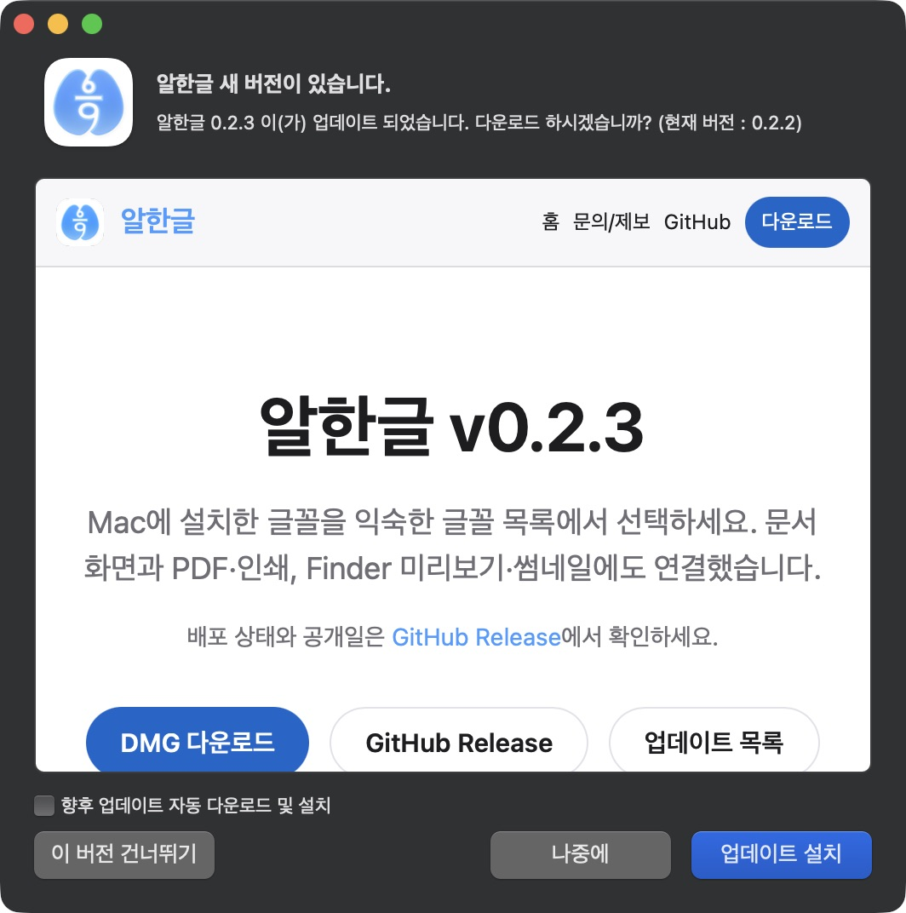
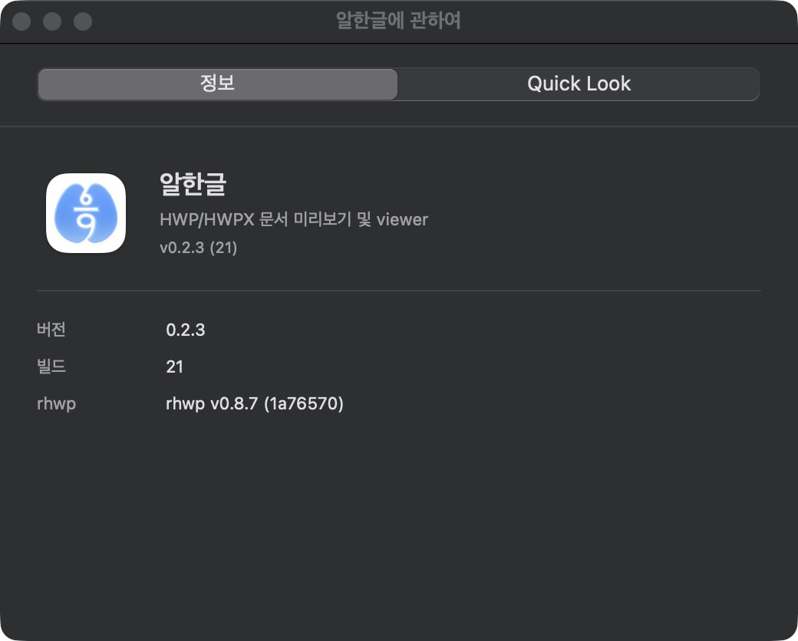
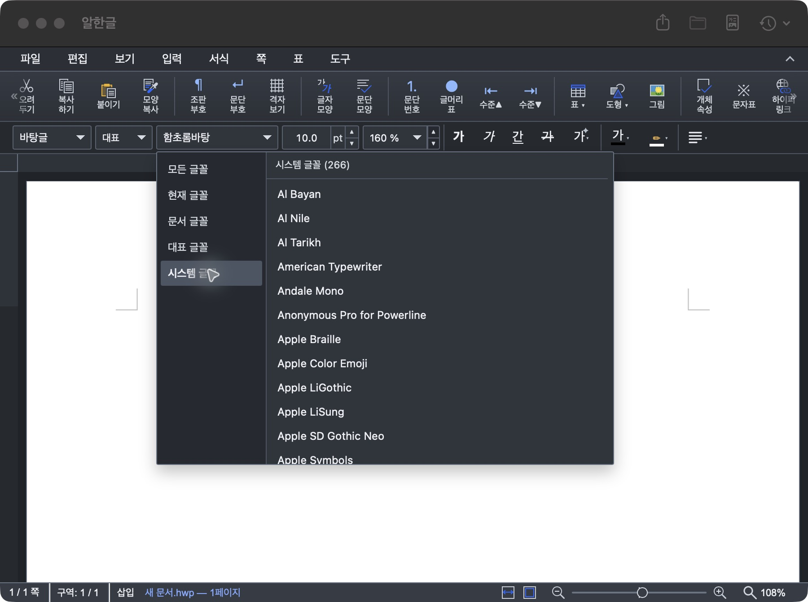
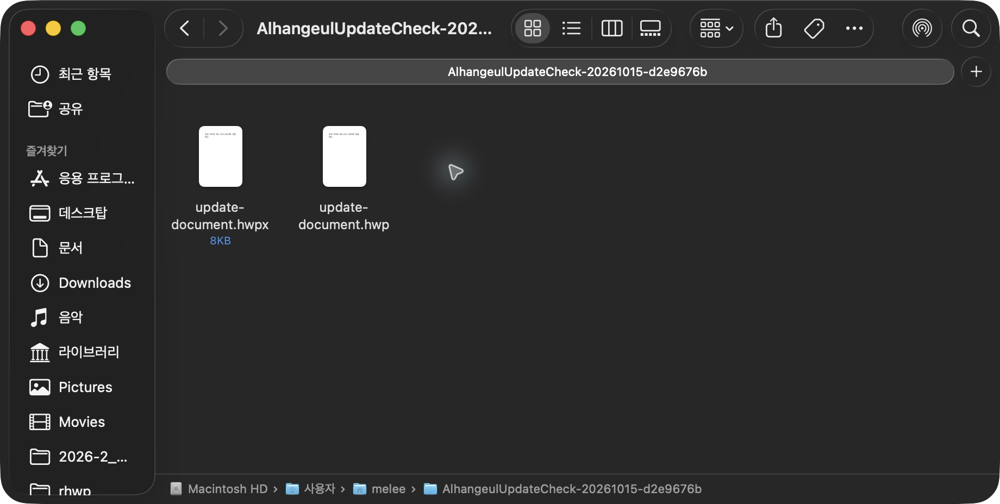

# Task M900 #584 Stage 5 — 동일 DMG 공개·업데이트 수용

## 결론과 승인

**2026-10-15 v0.2.3 / build 21 공개·Pages/Sparkle 배포, 실제 Sparkle 업데이트·글꼴/문서/Finder, Homebrew 배포·설치 시험과 원상복원을 완료했다.** 최종 보고 수용·종료 정리 게시/병합·후속 이슈 등록 승인을 받아 종료 PR #588 main 병합·공개 Pages/appcast 보존을 확인했고 #584는 CLOSED다. main 결과와 종료 기록을 devel로 인계한다.

작업지시자가 “동일 DMG의 양 VM 검색 PASS·실제 Mac 본문 추출 PASS를 대체 근거로 수용하고 Stage 5 진행 및 배포까지” 지시했다. 이어 [실행안](task_m900_584_stage5_remaining_plan.md)의 “Sparkle·Homebrew 시험/반영·앱 없음 복원까지 허용”을 승인했다. [Stage 4](task_m900_584_stage4.md)의 M7은 ENVIRONMENT_UNAVAILABLE로 유지하고 해당 대체 근거로 수용한다. 사용자가 인덱싱 중이라고 설명한 실제 Mac 검색은 별도 수동 시험·다음 릴리즈 조사로 남긴다. 원인·회귀 여부는 미확정이다. 과거 최근 문서 이력의 증거 공백과 #480/#525 한계도 해결로 바꾸지 않는다.

## 불변 후보·공개 결과

[실행 직전 조회](../report/assets/task_m900_584/stage5/preflight.json)에서 latest v0.2.2, upstream v0.8.7, 미만료 source/VM artifact 및 main/devel content gate를 확인했다. [정확한 입력](../report/assets/task_m900_584/stage5/promotion-inputs.json)으로 실행했다.

| 항목 | 결과 |
|------|------|
| source / tag | c9d59f9300ef78b4cc6a3a8e17a10a3d766d01d4 / v0.2.3, 네 bundle 0.2.3/21 |
| core·Studio | rhwp v0.8.7 / 1a76570e833917d15817415a53c09ad61ab3203f |
| 후보·검증 | publish 38180977764 / artifact 11717953850, validation 38185285770 / attempt 1 |
| [공개 실행](https://github.com/postmelee/alhangeul-macos/actions/runs/38629062837) | attempt 1, promote·deploy-pages 모두 SUCCESS |
| 공개일 | 2026-10-15 05:07:41 KST, Pages 05:09:05 KST 완료 |
| [Release](https://github.com/postmelee/alhangeul-macos/releases/tag/v0.2.3) | ID 409973398, latest v0.2.3·draft=false·prerelease=false |
| DMG / checksum 자산 | 632029048 / 632029049 유지. 재빌드·재공증·자산 교체 없음 |
| public DMG SHA256 / size | d0050cb7de5d3fea17708aef1bebb7da54d326c7a540afbaf28276c3e50b1e63 / 211405232 bytes |

[인증 없는 신규 다운로드](../report/assets/task_m900_584/stage5/public-download.json)는 후보와 같은 hash·checksum을 확인했다. [공개 파일 검증](../report/assets/task_m900_584/stage5/public-dmg-verification.json)의 hdiutil·staple·Gatekeeper도 통과했다. 파일이 같으므로 Stage 3의 universal·일반 앱 수용과 양 VM 결과를 연결한다. 이번 Homebrew 설치 앱에서도 네 실행 파일의 universal slice를 다시 확인했다.

[Pages](../report/assets/task_m900_584/stage5/pages.json)의 홈·/fonts/·새 노트·이전 노트·appcast는 모두 HTTP 200이다. 이전 버전 배너가 새 노트로 연결된다. [public appcast](../report/assets/task_m900_584/stage5/appcast.xml)는 version=21·shortVersion=0.2.3·동일 URL/length·EdDSA 서명을 제공한다. 실제 Sparkle 설치까지 별도 확인했다. 로컬 초기 XML 검사는 version을 enclosure 속성으로 가정해 실패했으며 item 자식 요소를 읽도록 보정했다. 제품/feed 수정은 없었다.

## 실제 Sparkle와 Mac 글꼴·Finder

macOS 26.5.2 (25F84)/arm64, 현재 앱이 없는 상태에서 공식 v0.2.2/20 공개 DMG를 검증해 임시 설치했다. [사전 보존](../report/assets/task_m900_584/stage5/preparation.json)에서 실제 UUID container·최근 문서 7개·sfl4·글꼴 catalog/policy·기존 Homebrew 0.2.2 metadata를 앱 실행 전에 확보했다. 이 Mac은 이전 후보 설치 이력이 있어 깨끗한 OS 최초 설치로 기록하지 않는다.

1. 업데이트 전 PID 37569·0.2.2/20을 확인했다. Sparkle UI에서 0.2.3을 발견하고 실제 다운로드·설치 및 자동 재실행을 수행했다.
2. UI 도구의 재조회/실행 전에 [새 PID 38722와 0.2.3/21](../report/assets/task_m900_584/stage5/sparkle-relaunch.json)을 기록했다. About도 rhwp v0.8.7을 표시했다. 설치 파일 strict seal·Homebrew 설치본과 실행 파일 hash 일치를 확인했다.
3. 소유 HWP/HWPX가 각각 열리고 기존 NanumSquare 이름과 원문이 표시됐다. 설정의 Mac 글꼴 기본 OFF 유지 후 ON으로 변경하고 정상 종료·수동 재실행에서도 ON이 유지됐다. 이번 실제 catalog는 298 family/936 records, 시스템 목록은 266개였다. 이전 232/204개를 정답으로 고정하지 않았다.
4. 접근성 AXPress로 select를 누르면 브라우저 기본 선택창이 열려 시스템 그룹을 확인하지 못했다. 실제 포인터 클릭에서는 분류 메뉴의 시스템 글꼴 266개가 정상 표시됐다. 앞선 관측을 제품의 그룹 누락·회귀로 확정하지 않는다. 포인터 비교는 수동 재실행 후 확인했으므로 첫 ON의 즉시 전파까지 소급 PASS로 확대하지 않는다.
5. [설치된 확장 등록](../report/assets/task_m900_584/stage5/sparkle-extensions.json)은 /Applications의 preview·thumbnail 0.2.3을 선택했다. 실제 HWP/HWPX Quick Look과 새 홈 폴더 경로의 두 썸네일을 확인했다. 기존 build.noindex 경로의 초기 일반 아이콘과 새 경로 결과를 구분한다. 기본 열기 앱인 한컴 Viewer와 사용자 Finder 검색 창은 바꾸지 않았다.
6. Spotlight GUI 검색·결과 열기·종료 후 검색은 이번 Mac에서 새 PASS로 기록하지 않는다. 수용한 VM 검색·실제 importer 추출을 근거로 하고 원인 조사는 후속이다.

[글꼴·문서 결과](../report/assets/task_m900_584/stage5/sparkle-font-documents.json), [Finder 결과](../report/assets/task_m900_584/stage5/finder.json)에 범위를 기록했다.

## Homebrew

[postmelee/homebrew-tap PR #2](https://github.com/postmelee/homebrew-tap/pull/2)의 실제 diff는 version/hash 두 줄뿐이다. Ruby 문법과 [실제 tap의 style·일반 audit](../report/assets/task_m900_584/stage5/homebrew-checks.json)을 통과했고 검토 head 056f4d5b78cebb8cb7f760d2bfbfb9fefe944d24를 지정해 merge했다. [병합 기록](../report/assets/task_m900_584/stage5/homebrew-pr.json)의 main은 fee6666ab3716d3c2858d49e55bb5d64eaff2d65다. 별도 tap CI는 없었으며 이를 CI PASS로 표시하지 않는다.

[실제 설치 검증](../report/assets/task_m900_584/stage5/homebrew-install.json)은 기존 0.2.2 receipt → 0.2.3 upgrade, 제거·신규 설치, 네 실행 파일 universal·strict seal·staple·Gatekeeper를 통과했다. upgrade 전 앱 자체는 이미 Sparkle로 0.2.3이어서 이 경로를 별도의 0.2.2 앱 bytes 업그레이드로 세지 않는다. 이후 신규 설치가 0.2.3/21이며 Sparkle 설치본과 같은 실행 파일 hash임을 확인했다.

초기 전용 checkout의 style은 tap 밖이라 거절됐고 실제 tap에 두 줄 변경을 잠시 적용해 검사한 뒤 원래 bytes를 복원했다. 첫 설치 검증의 fully-qualified brew list 조회 실패는 token alhangeul로 보정했으며 첫 시도는 조회에서 중단됐다. --zap·전역 캐시 초기화·다른 사용자 Cask 정리는 하지 않았다. 본 저장소 Cask도 동일한 공개 hash로 정렬했다. GitHub Release의 Homebrew 안내는 실제 명령으로 보정했으며 README·웹 badge 정렬은 종료 정리 PR에 포함한다.

## 원상복원·등록·공간

[복원 결과](../report/assets/task_m900_584/stage5/restoration.json): 앱 없음, 변경된 설정 7개, native recent 7개의 정확한 bytes와 앱별 sfl4, catalog·공유 policy·권한의 사전 상태를 복원했다. 기존 Homebrew 0.2.2 receipt만 남아 있고 앱이 없던 초기 상태도 복원했다. 공개 tap main 0.2.3 반영은 유지한다. 수동 TXT와 사용자 Finder 검색 창은 보존했고 TXT hash는 같다. 새 소유 HWP/HWPX 폴더만 hash 확인 뒤 제거했다. 10월 13일 이전 이력 공백을 해결했다고 주장하지 않는다.

첫 등록 위생 검사에서 이 타스크의 VM 증거에서 추출된 metadata-only .app 3개가 남아 있었다. 66개 파일을 ZIP/hash로 보존하고 해당 등록·폴더만 정리했다. [최종 위생 검사](../report/assets/task_m900_584/stage5/registration-cleanup.json)는 PASS이며 앱 부재에 따른 provider 없음 경고는 예상 상태다. 첫 실패는 삭제하지 않고 원시 로그에 보존했다. 전역 등록·색인·캐시 reset은 없다.

중복 public DMG 두 개·전용 Homebrew 캐시·병합한 임시 tap checkout의 논리 합계 667,383,441 bytes(약 636MiB)를 정리했다. 물리 회수량과 같다고 주장하지 않는다. 원본 공증 후보·복원 증거는 보존했다. [공간 정리](../report/assets/task_m900_584/stage5/storage-cleanup.json)를 참고한다. 스크린샷 9개는 실제 JPEG bytes에 맞춰 .jpg로 저장하며 재인코딩하지 않았다.

## 필요한 회귀와 종료 정리

README·홈/업데이트 Homebrew 안내·Cask·수용표·릴리즈 기록·최종 보고서를 한 main 대상 종료 정리 PR로 모은다. 공개 appcast를 그대로 보존한 docs-only 배포와 devel 인계를 확인해야 한다. 새 Spotlight 조사 이슈 초안은 [후속 초안](task_m900_584_spotlight_followup_issue.md)에 준비했다. 기존 #513은 v0.2.2에서 이미 종료됐으므로 새 관측을 근거 없이 같은 회귀로 병합하지 않는다. 작업지시자가 최종 보고·게시/병합·이슈 등록/종료를 승인했고 [Spotlight 후속 #587](https://github.com/postmelee/alhangeul-macos/issues/587)을 등록했다. 제품 재빌드·태그 이동·새 서명은 하지 않는다.

검증: 변경 Markdown 13개·상대 링크 261개, JPEG 파일 형식 9개·최소 증거 checksum 28개, 공백 검사, Pages 조립과 public appcast bytes 보존·Homebrew 업데이트 탭 화면 확인을 통과했다. 제품 코드·Rust/core·Studio·bundle 버전·고정 태그는 추가 변경하지 않았다. [검증 요약](../report/assets/task_m900_584/stage5/validation.json)을 참고한다.

신규 실행안의 diff 예시 안에 남은 한 칸 공백을 staged 공백 검사에서 발견해 제거했다. 최종 staged 검사까지 통과한 상태로 게시 준비한다.

## 종료 정리 결과

종료 [PR #588](https://github.com/postmelee/alhangeul-macos/pull/588)은 검토 head `560f229c`의 실행 대상 CI 3개 성공 후 main `1688bc38`에 병합됐다. docs-only Pages run 38635318675 성공·공개 Homebrew 0.2.3 안내·기존 1161 bytes appcast 보존을 확인했다. #584는 완료 처리했고 #587은 별도 조사로 유지한다. [최종 보고](../report/task_m900_584_report.md)의 종료 증거와 완료 기록을 main 기준의 devel 인계 PR에 함께 담는다. 인계 CI·검토·병합과 브랜치 정리가 남으며 제품·DMG 변경은 없다.
